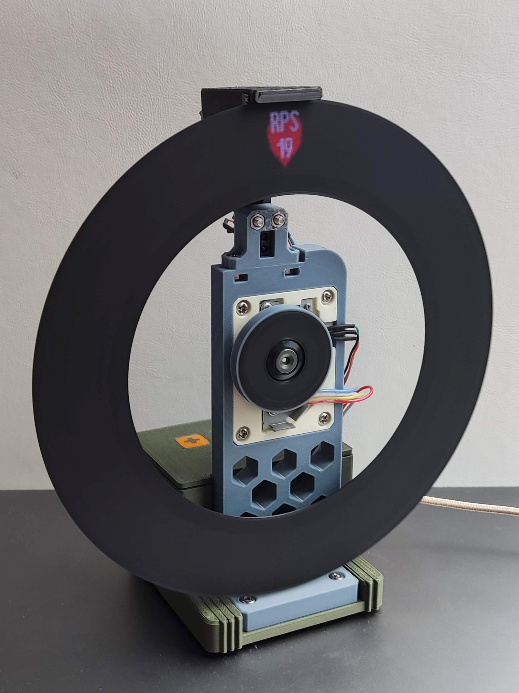
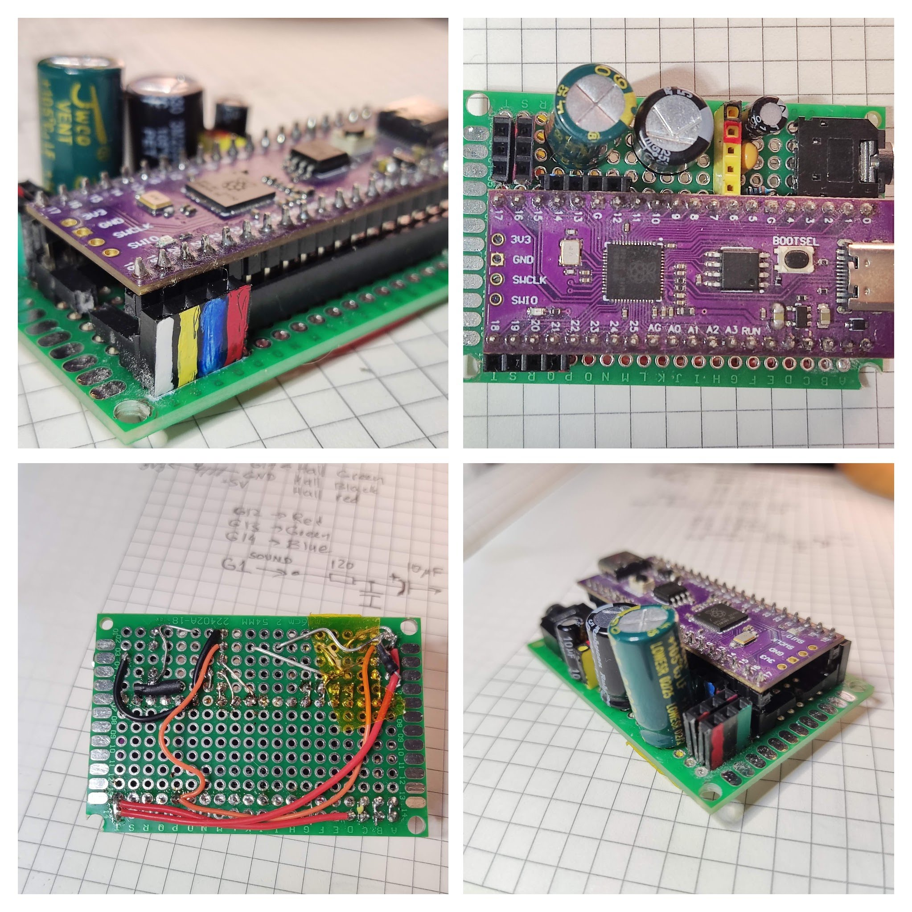
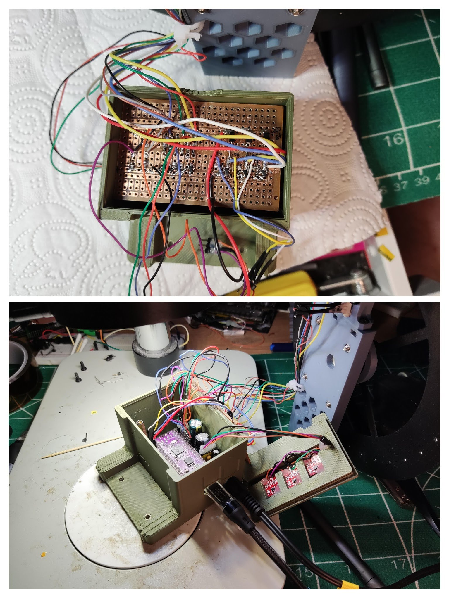

Nipkow disc mechanical televisor
================================

Video: [youtube](https://www.youtube.com/watch?v=4iRMbndLoC4)

## Features

  * can be used without computer, only a USB power brick is needed to demo
  * 32-lines RGB mechanical tv, 10-40 FPS, or RPS depening on how you look at it
  * diffuser integrated in the disc, simplifies construction and improves visibility
  * All mechanical parts are 3D printed, A1-mini compatible (180x180 build plate)
  * external sound output on 3.5mm jack
  
The controller is a RP2040 Raspberry Pi clone. It has 16MB flash which is enough to store plenty of demo video.

## Build details

Built on breadboard, then transferred to prototype boards.

The MCU + sound:

MOSFETs board:

## Parts list

Not a proper BOM, but a list of parts that I used.

 * DVD motor with a central tap, approx 1.9 ohm per winding
 * single A3144 hall sensor for commutation (power by 5V)
 * 10K pullup resistor for the hall sensor (pull up to +3V3)
 * AO3400 MOSFETs 6x: 3 for the motor, 3 for RGB; other mosfets should be able to fully open with 3V3 from the pico
 * 100R inline with MOSFET gates, 100K pull downs on MOSFET gates to bleed off the charge
 * SS34 or similar diodes for motor coil flyback
 * 3W RGB LED (should have separate LED pins, or common anode for low-side switching)
 * TTP223 touch sensor boards for the UI: next/prev, freeze frame, FPS adjust, sync adjust (can be replaced with any buttons)
 * 22..50pF capacitors to tune down TTP223 sensitivity
 * ST188 optical sensor (and resistors)
 
## CAD files

[cad files](cad)

## Notes

Extra notes and project build log can be found on [hackaday.io project page](https://hackaday.io/project/207125-mechanical-tv-display)
